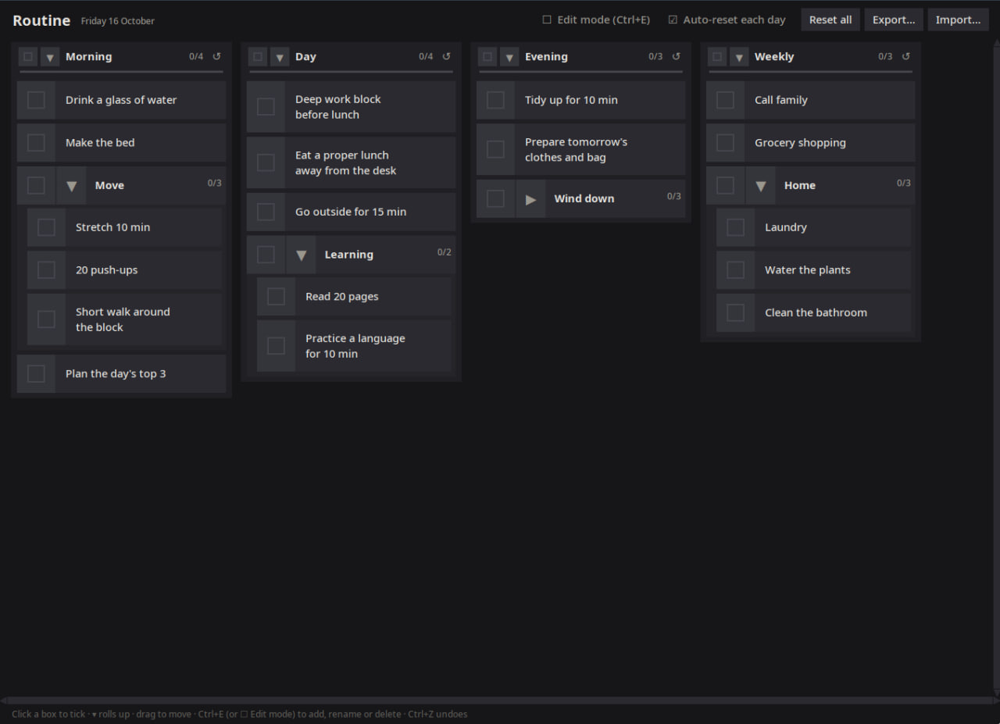

# Routine

A habit board for daily routines. Tick things off through the day, and the board resets itself the next morning.



## Features

- **Columns of habits.** Each list is a column (Morning, Day, Evening, …) and can hold sublists, nested to any depth.
- **Tick off a habit or a whole list.** Each list shows a `done/total` count, and you can roll a list up (▾/▸) to hide its items.
- **Drag to rearrange.** Move habits and lists within a column or between columns.
- **Auto-reset every day.** You can also reset everything by hand, or reset a single list with ↺.
- **Edit mode** (`Ctrl+E`) to add, rename and delete. `Ctrl+N` adds a new list.
- **Undo/redo** with `Ctrl+Z` and `Ctrl+Shift+Z` / `Ctrl+Y`.
- **Export/import** the board as JSON.

## Running

Routine is a single Python file and needs nothing beyond the standard library (with Tkinter):

```sh
./routine.py      # or: python3 routine.py
```

The window's X class is `Routine`, so you can match it in window manager rules, for example in i3:

```
for_window [class="Routine"] floating enable
```

## Data

Your board is saved to `data.json` next to the script whenever you change something. You can also edit that file by hand: the running app picks up the changes within a couple of seconds.

```json
{
  "day": "2026-10-16",
  "autoReset": true,
  "lists": [
    { "title": "Morning", "items": [
      { "text": "Drink a glass of water" },
      { "title": "Move", "items": [ { "text": "Stretch 10 min" } ] }
    ] }
  ]
}
```

An entry that has `items` is a list, and any other entry is a habit. When you add entries by hand, you can leave out `id`, `done` and `collapsed`, because the app fills them in. If `data.json` isn't valid JSON, the app won't start, so it never overwrites your data.
